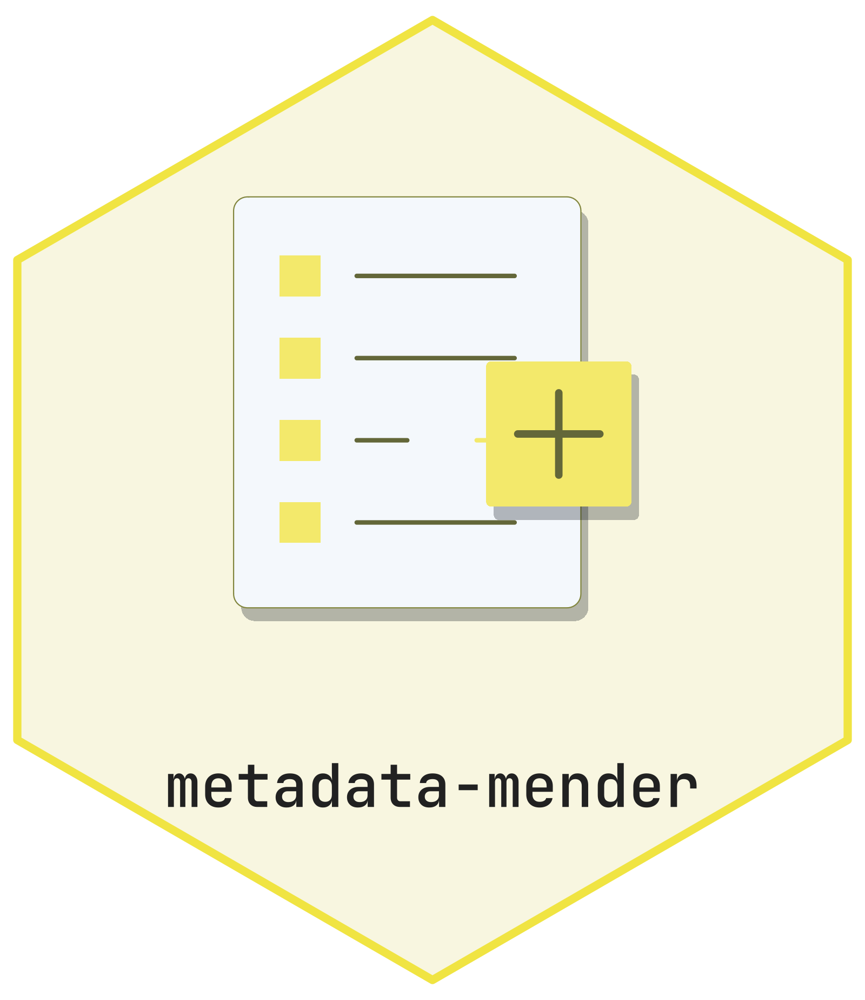

<picture class="cttir-readme-logo"><source class="cttir-logo-dark-source" media="(prefers-color-scheme: dark)" srcset="assets/branding/logo-with-name-dark.png" /></picture>

# Metadata Mender

[](https://doi.org/10.5281/zenodo.21889980)

A Zotero 9–10.0 plugin that reconciles and completes item metadata by looking up the
item's **DOI**, **PMID**, or **CRAN package id** against eight free databases —
**PubMed (NCBI E-utilities)**, **OpenAlex**, **Crossref**, **Semantic Scholar**,
**OpenAIRE** (grey literature), **Unpaywall**, **CORE**, and **CRAN** (R
packages, via METACRAN) — and merges the results back onto the item. It also
records the current **citation count** and **OpenAlex 2-year mean
citedness** with a date stamp, and surfaces the **Open Access PDF link** when
available.

## What it does

- Right-click one or more items → **Mend metadata (DOI/PMID lookup)**.
  The menu item is hidden automatically when no regular item is selected.
- For each item it reads the DOI (from the DOI field or `Extra`) and PMID
  (from `Extra`), queries the configured sources, and fills in or corrects:
  title, date, journal/publication title, volume, issue, pages, ISSN,
  abstract, URL, publisher, and authors.
- If the item has neither a DOI nor a PMID, the plugin can optionally fall
  back to a Crossref bibliographic search. This is **off by default**. Adoption
  requires one distinct DOI among candidates with a near-identical title
  (Jaccard ≥ 0.92), matching first-author surname, publication title and item
  type, and publication year within one year. Missing evidence means no match.
- Items are processed in parallel (configurable, default 4 workers). Per-source
  rate limits are still respected, so a batch only goes faster where one source
  is idle while another is waiting.
- A progress popup ticks per item and can be cancelled with **Esc**.
- Items that get changes are tagged according to the configured tag policy:
  - *Latest run* (default) — single `mended:YYYY-MM-DD` tag, replacing any
    previous automatic date tag on that item. Manual tags are preserved.
  - *Full history* — accumulates one `mended:YYYY-MM-DD` tag per run date.
  - *Stable* — a single `mended` tag without a date.
- Per-item errors (after retries) are shown inline in the progress popup —
  up to five with their failure reasons, plus a "…and N more" line when
  truncated. Sanitized failure details go to **Help → Debug Output**.

### Extra-field lines written

The plugin writes these structured lines to `Extra`. Stable identifiers are
appended once; temporal data is rewritten on every run with today's date.

| Line               | Behaviour | Source |
|--------------------|-----------|--------|
| `PMID: <id>`       | Append once | discovered from PubMed or Semantic Scholar |
| `PMCID: PMC<id>`   | Append once | OpenAlex, PubMed, or Semantic Scholar |
| `arXiv: <id>`      | Append once | Semantic Scholar |
| `OpenAlex: W<id>`  | Append once | OpenAlex |
| `Citations: <n> [<source>, YYYY-MM-DD]` | Rewritten every run | OpenAlex preferred; falls back to Crossref or Semantic Scholar |
| `OpenAlex 2yr mean citedness: <x.xx> [OpenAlex 2yr mean citedness, YYYY-MM-DD]` | Rewritten every run | OpenAlex venue lookup |
| `OA-URL: <url>`    | Rewritten every run | Cascade — OpenAlex → Unpaywall → OpenAIRE → CORE |
| `Provenance: YYYY-MM-DD — field:source, …` | Rewritten on any change | derived from the actual merges performed |

Citation count is pinned to OpenAlex (with a fallback) so the time series
stays comparable across runs.

## Sources, keys, and rate limits

All keys are **optional**. Configure them in
**Zotero → Settings → Metadata Mender**.

| Source           | Works without a key?              | What a key/email buys you |
|------------------|-----------------------------------|---------------------------|
| PubMed           | Yes (3 requests/sec)              | An NCBI API key raises the limit to 10 requests/sec. |
| OpenAlex         | Single DOI/PMID lookups are free  | An API key is required beyond the free daily allowance and raises throughput. |
| Crossref         | Yes                               | A contact email (`mailto`) joins the faster *polite pool*. A *Crossref Plus* token unlocks the premium pool. |
| Semantic Scholar | Yes (~1 req/sec, shared)          | An API key reserves headroom and raises the throttle. |
| OpenAIRE         | Yes                               | Broad coverage of grey literature (theses, reports, working papers, repository deposits) — especially European/funded research. |
| Unpaywall        | Requires the contact email only   | Best-in-class discovery of open-access PDFs (especially repository copies). No API key. |
| CORE             | **No** (anonymous budget is too small to be useful) | A free API key unlocks the 10 tokens/minute tier and gives access to direct full-text PDF URLs. |
| CRAN (METACRAN)  | Yes                               | Resolves R-package metadata (Title, Description, Version, Authors, Date, License, URL). |

## Source priority

Default order: `pubmed,openalex,crossref,semanticscholar,openaire,unpaywall,core,cran`.

The first source with a non-empty value for a given field wins. PubMed and
OpenAlex are queried first because they have the highest signal for the
biomedical items most users curate; the others fill gaps. Citation count is
pinned to OpenAlex regardless of priority (with a fallback). The separately
labelled 2-year mean citedness comes from OpenAlex; it is not a journal impact
factor. Existing manual or legacy `Impact Factor:` lines are preserved.

The plugin adapts its request pacing automatically based on which keys are
present. On HTTP **429** or **5xx** it retries up to twice, honouring
`Retry-After` up to 30 seconds per retry. Longer server delays stop that lookup.
Each request times out after 30 seconds; redirects are refused. **404** means
"no record". Exact returned identifiers are checked before any merge.

Where to get keys:

- **OpenAlex** — free account at <https://openalex.org/settings/api>
- **NCBI** — free, under your account at <https://www.ncbi.nlm.nih.gov/account/>
- **Semantic Scholar** — request at <https://www.semanticscholar.org/product/api>
- **CORE** — free, register at <https://core.ac.uk/services/api>
- **Crossref Plus** — paid; only if you have a subscription
- **Unpaywall** — no key; uses the contact email you already set for Crossref
- **OpenAIRE** — no key required
- **CRAN (METACRAN)** — no key required

## R packages (CRAN)

To mend a software item that represents an R package, give it one of:

- A URL like `https://cran.r-project.org/package=ggplot2` in the Zotero **URL**
  field; the package name is parsed automatically.
- A line `CRAN: ggplot2` in **Extra**.

The plugin then queries METACRAN (`crandb.r-pkg.org`) for the package's
DESCRIPTION and fills in title (package name), abstract (Description), date
(Date/Publication), authors (parsed from the DESCRIPTION Author field, with
`[role]` tags and ORCID parentheticals stripped), version, programming
language ("R"), publisher (CRAN), and URL (the CRAN package page). It also
writes `License:`, `Upstream-URL:`, and `CRAN:` lines to Extra.

If your item type isn't `computerProgram`, the version is stashed as a
`Version:` line in Extra rather than dropped.

## Settings

- **Contact email (mailto)** — used in the User-Agent, Crossref's polite-pool
  query, and as the required identifier for Unpaywall. Setting it also enables
  the Unpaywall source.
- **Source priority** — comma-separated, highest first. Default
  `pubmed,openalex,crossref,semanticscholar,openaire,unpaywall,core,cran`. The first
  verified source that supplies a field wins. Citation metrics are special: see above.
- **Update mode**
  - *Fill empty fields only* (default) — never touches standard fields you
    already have.
  - *Overwrite existing fields* — replaces existing values with the
    highest-priority source's value.
- **Look up DOI by title when item has no DOI/PMID** — off by default. Enable
  only for records with an author, year, publication title and supported type.
- **Abbreviate author first names to initials** — off by default. Fill mode
  preserves existing creator names even when this option is enabled.
- **Mended-tag policy** — *latest* / *history* / *stable* (see above).
- **Parallel items per batch** — 1 to 12, default 4. Higher is only helpful
  when you have keys that raise the per-source RPS budgets.
- Citation count, mean citedness, OA URL, and provenance are updated on each
  run regardless of update mode (they are time-stamped readings, not stable
  bibliographic metadata).
- For item types that don't expose a Zotero `DOI` field (books, theses, …) a
  discovered DOI is written as `DOI:` in `Extra` instead of being silently
  dropped.

## Run summary

After each batch the progress popup reports:

`Done. N updated, N unchanged, N skipped, N not found, N errored.`

- **updated** — at least one field or Extra line changed (and a
  `mended:YYYY-MM-DD` tag was added).
- **unchanged** — sources answered but had nothing new to add.
- **skipped** — no usable identifier, a protected or edited item, or cancellation.
- **not found** — every queried source returned 404 (work not indexed).
- **errored** — no verified metadata was available, identity checks failed, or a
  save failed. Partial source failures also appear even when another source updated the item.

Press **Esc** to cancel pending work. A response arriving after cancellation
will not be applied; a save already underway may finish. The summary reads
"Cancelled. …" with whatever was accumulated so far.

Read-only libraries, trashed items, and items with pending edits are skipped.
If an item changes while metadata is fetched, it is skipped for review. Failed
saves reload the original stored state. Existing saved settings are preserved
on upgrade: check **Update mode** if an earlier version enabled overwrite.

## Install

**Declared compatibility:** Zotero 9.0 through 10.0.x. See the
[qualification record](docs/AUDIT-2026-10-30.md) for tested behavior and limits.

1. Download `metadata-mender-<version>.xpi` from the
   [Releases page](https://github.com/CTTIR/metadata-mender/releases).
2. In Zotero: **Tools → Plugins → gear icon → Install Plugin From File…**
3. Select the `.xpi`. Restart Zotero if prompted.

## Documentation

Published guide: <https://cttir.github.io/metadata-mender/>. The local
`docs/index.qmd` includes the current candidate changes until the site is published.

## Build from source

Prerequisites: Python 3.9 or later for packaging; Node.js 22 or later for tests.
No dependency installation is needed. From the repository root:

```bash
node --test tests/*.test.js*.test.js
./build.sh
python3 tools/build.py --check metadata-mender-0.6.1.xpi
```

Produces the current XPI deterministically and verifies its runtime files against
source. Earlier version artifacts remain in place. Install this local XPI using
the steps above, then first try one disposable reference in a separate library
with **Fill empty fields only** selected.

## Tests

```bash
node --test tests/*.test.js
```

Tests exercise reconciliation, identity mismatches, stale and protected items,
cancellation, save rollback, credential-safe errors, Extra preservation, strict
title matching, helpers, and reproducible packaging. They use a VM with a Zotero
data-model stub, so they do not establish desktop UI compatibility. CI runs the
same checks and verifies the XPI; see the audit record for observed local results.

## Release

Push a tag `vX.Y.Z` matching `manifest.json`'s version. The `release` job in
the CI workflow builds the XPI and attaches it to a GitHub release. Don't
forget to bump `update.json` to the same version.

## Notes & limitations

- Only regular items (not notes/attachments) are processed.
- Items need a DOI, PMID, explicit CRAN package id, or an opted-in verified title match.
- Metadata lookups send the selected identifiers to configured services. Optional
  title search sends the title and first author to Crossref; email and keys are
  sent to their providers. Credentials remain in Zotero preferences.
- Zotero's own HTTP debug output may include lookup identifiers, titles, and
  contact email. Review logs before sharing them. Plugin error messages redact
  request URLs and credential values.
- An identifier match does not prove the local reference is correct: conflicting
  titles or authors are refused. Review source metadata before enabling overwrite.
- Conflicting native/Extra identifiers and malformed identifiers are skipped for
  review before any lookup. CRAN URL detection requires the actual CRAN host.
- Run Mender before a Zotero Library Workbench extraction/audit. Close Zotero for
  Workbench operations and regenerate correction plans after library changes.
  Do not run competing metadata writers at the same time.
- OpenAlex abstracts are reconstructed from its inverted-index format; Crossref
  abstracts are stripped of JATS XML tags.
- Author name parsing is heuristic (especially for PubMed's "Surname IN" form);
  spot-check author fields after a bulk run in *overwrite* mode.
- OpenAlex 2-year mean citedness is a distinct metric, not the Clarivate JIF.
  Items without an indexed venue do not receive this line.
- The bundled icons in `content/icons/` use the CTTIR Coder Edition v5 symbol.

## How to cite

If Metadata Mender contributes to a publication, please cite it.

**BibTeX**

```bibtex
@software{heller_metadata_mender_2026,
  author  = {Heller, Raban},
  title   = {Metadata Mender: a Zotero plugin for reconciling item
             metadata against PubMed, OpenAlex, Crossref, Semantic
             Scholar, OpenAIRE, Unpaywall, CORE, and CRAN},
  year    = {2026},
  version = {0.6.1},
  url     = {https://github.com/CTTIR/metadata-mender},
  license = {MIT}
}
```

**APA**

> Heller, R. (2026). *Metadata Mender: a Zotero plugin for reconciling item
> metadata against PubMed, OpenAlex, Crossref, Semantic Scholar, OpenAIRE,
> Unpaywall, CORE, and CRAN* (Version 0.6.1) [Computer software].
> https://github.com/CTTIR/metadata-mender

The archived 0.1.0 release has the DOI shown below. Do not treat that
version-specific archive as a deposit of the local 0.6.1 candidate.

## Links

- Documentation: <https://cttir.github.io/metadata-mender/>
- Issues: <https://github.com/CTTIR/metadata-mender/issues>
- Releases: <https://github.com/CTTIR/metadata-mender/releases>

## License

[MIT](LICENSE).

## Archived citation

The existing archived release is:

> Heller, R. (2026). *Metadata Mender: Reconciling Zotero item metadata against public bibliographic services* (Version 0.1.0) [Computer software]. Zenodo. https://doi.org/10.5281/zenodo.21889980

DOI: [10.5281/zenodo.21889980](https://doi.org/10.5281/zenodo.21889980)

## Use of LLM tools

Where applicable, LLM tools were used for narrowly defined, non-authorial tasks:
copyediting, prose refinement, Markdown/LaTeX formatting, boilerplate scaffolding
(such as CI configurations and build scripts), and code refactoring. Tools included
[Chat AI](https://kisski.gwdg.de/leistungen/2-02-llm-service/), the KISSKI
(GWDG) service, and self-hosted **Mistral Small (24B, Apache-2.0)** served through
a local **vLLM architecture** on an Ubuntu Linux workstation with Intel
processors and NVIDIA GPUs. The self-hosted model ran locally, with no data sent
to third parties.

All scientific claims, methodological choices, analyses, interpretations and
conclusions remain the authors' own. Where applicable, LLM-generated material
must be reviewed and revised before inclusion, and references must be verified
against their DOI, arXiv ID or ISBN.

Local software setup: vLLM with Python/PyTorch, plus R and RStudio.

## Branding

The supplied CTTIR Coder Edition v5 artwork and its editable R source are in
[`tools/branding`](tools/branding/README.md). Use that renderer to reproduce
the primary badge, alternate editions, and platform icons.
